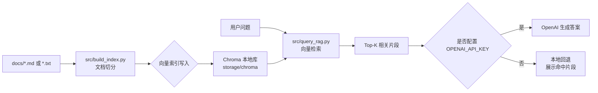

# 本地向量数据库 + RAG 快速启动

这个项目已经配置好一个最小可运行的 RAG 流程，目标是：

- 本地搭建向量数据库（Chroma 持久化到本地目录）
- 能直接执行索引与查询脚本，跑通 RAG 主流程
- 在 README 中记录完整启动步骤，方便后续复用

## 执行 Checklist（建议按顺序勾选）

- [ ] Python 环境可用（`python --version` 或 `conda run -n base python --version`）
- [ ] 安装依赖（`pip install -r requirements.txt`）
- [ ] 准备知识文件（`docs/` 下至少一个 `.md` 或 `.txt`）
- [ ] 构建向量索引（`python src/build_index.py --rebuild`）
- [ ] 执行检索问答（`python src/query_rag.py "你的问题"`）
- [ ] （可选）配置 `OPENAI_API_KEY` 进行生成增强

提示：如果企业网络导致 `pip install` 失败，当前项目已内置“无第三方依赖 fallback 模式”，仍可完成本地索引与检索问答流程。

## 项目结构

```text
RagProj/
├─ docs/                    # 放你的知识文档（.md/.txt）
│  └─ sample_knowledge.md
├─ src/
│  ├─ build_index.py        # 文档切分 + 向量索引构建
│  └─ query_rag.py          # 检索 + 生成（支持 OpenAI，可回退）
├─ storage/
│  └─ chroma/               # 本地向量数据库目录（运行后自动生成）
├─ .env.example
├─ .gitignore
└─ requirements.txt
```

## 架构图（Mermaid）



## 1) 创建并激活 Python 虚拟环境

在 PowerShell 中执行：

```powershell
cd d:\workspace\US\code\RagProj
python -m venv .venv
.\.venv\Scripts\Activate.ps1
```

如果你本机没有 `python` 命令，但已有 `conda`，可以直接使用：

```powershell
conda run -n base python --version
```

## 2) 安装依赖

```powershell
pip install -r requirements.txt
```

如果使用 conda 的 Python：

```powershell
conda run -n base python -m pip install -r requirements.txt
```

### 公司代理网络说明（PAC）

已知你的浏览器使用 PAC：

```text
http://pac.zscalertwo.net/philips.com/china-pac-vip.pac
```

从 PAC 可解析到的代理节点为：

```text
PROXY 165.225.116.35:80
PROXY 147.161.192.28:80
```

在终端内可尝试临时设置代理后安装（当前终端有效）：

```powershell
$env:HTTP_PROXY='http://165.225.116.35:80'
$env:HTTPS_PROXY='http://165.225.116.35:80'
conda run -n base python -m pip install -r requirements.txt -i https://pypi.org/simple
```

如果依然超时，通常是因为 PAC 的认证/路由策略只在浏览器或系统代理栈中生效，`pip` 不能直接使用 PAC 逻辑。此时建议：

1. 让 IT 提供可用于 CLI 的固定代理地址（含认证方式）。
2. 或先在可联网环境下载离线 whl，再内网离线安装。

### 无依赖 Fallback 模式（网络受限可用）

当 `chromadb` 无法安装时：

- `src/build_index.py` 会自动构建 `storage/local_index.json`
- `src/query_rag.py` 会自动从该本地索引检索

可直接执行：

```powershell
python src/build_index.py --rebuild
python src/query_rag.py "RAG 的核心流程是什么？"
```

## 3) 准备知识库文件

把你的知识内容放到 `docs/` 下，支持：

- `.md`
- `.txt`

你可以先用自带示例文件 `docs/sample_knowledge.md`。

## 4) 构建本地向量数据库

首次构建（或重建）执行：

```powershell
python src/build_index.py --rebuild
```

成功后会看到类似输出：

```text
Indexed N chunks into collection 'rag_docs'.
```

向量数据会保存在本地 `storage/chroma/`。

## 5) 进行 RAG 查询

```powershell
python src/query_rag.py "RAG 的核心流程是什么？"
```

默认会先检索 `top-k=4` 片段，再进入生成阶段。

可调参数：

```powershell
python src/query_rag.py "你的问题" --top-k 6
```

## 6) 可选：接入 OpenAI 做生成

如果你希望查询结果由模型生成更自然的答案：

1. 复制环境变量模板并填写：

```powershell
Copy-Item .env.example .env
```

2. 在 `.env` 中设置：

```text
OPENAI_API_KEY=你的key
OPENAI_MODEL=gpt-4o-mini
```

脚本会自动检测 `OPENAI_API_KEY`：

- 已配置：使用 OpenAI 生成答案
- 未配置：使用本地回退模式，展示检索命中片段

## 7) 日常更新知识库

每次你新增或修改了 `docs/` 中的文件后，建议重新建索引：

```powershell
python src/build_index.py --rebuild
```

## 8) SRS xlsx 建库与问答

如果你已经生成了：

`docs/SRS/SRS_baseline_25.76(VM14.0 SVAL-R)_preprocessed.xlsx`

可以直接执行 SRS 专用流程：

1. 从 xlsx 建立向量库

```powershell
python src/build_srs_index.py --input "docs/SRS/SRS_baseline_25.76(VM14.0 SVAL-R)_preprocessed.xlsx" --sheet Sheet1 --rebuild
```

2. 用关键词或自然语言查询（可接 LLM）

```powershell
python src/query_srs_rag.py "Aux 1 相关要求是什么？" --retrieve-k 100 --top-k 50
```

说明：

- 如果本机 Ollama 可用，会优先走“检索 + Ollama 生成”
- 如果配置了 `OPENAI_API_KEY` 且 Ollama 不可用，会走“检索 + OpenAI 生成”
- 如果两者都不可用，会先返回 Top-K 命中需求片段
- `--retrieve-k` 表示先召回多少个候选再排序，默认 100；`--top-k` 表示最终展示多少条，默认 50。

### 本地 Ollama LLM

默认支持本机 Ollama：

```text
OLLAMA_BASE_URL=http://localhost:11434
OLLAMA_MODEL=dagbs/qwen2.5-coder-14b-instruct-abliterated:q5_k_m
```

如果你的 Ollama 服务和模型已就绪，`src/query_srs_rag.py` 和 Web 页面会优先用 Ollama 生成答案。

### 中文查询转换 API

中文查询不再依赖本地 `query_synonyms.json`。如果需要把中文问题转换成英文关键词，可部署一个 API，并设置：

```powershell
$env:QUERY_TRANSLATE_API_URL="http://your-server/translate-query"
```

接口约定：

- 请求：`POST` JSON，形如 `{"query":"主板"}`
- 响应：JSON 中包含 `query`、`translated`、`keywords` 或 `english` 任意字段之一

示例响应：

```json
{"keywords":["motherboard","main board"]}
```

### Web 查询界面

启动本地 Web：

```powershell
python src/web_srs_rag.py --host 127.0.0.1 --port 8000
```

浏览器打开：

```text
http://127.0.0.1:8000
```

## 常见问题

## TODO

- [x] 去掉 `query_synonyms.json`，改为 API 调用方式做中文到英文查询转换；这块 API 服务需要后续单独部署。
- [x] 制作一个 Web 页面/服务，可以进行简单对话，并基于当前向量数据库内容做知识库查询。
- [ ] 继续优化向量数据库检索质量。已完成阶段性改进：`--retrieve-k` 扩大召回池 + 词法重排。后续应替换为真正的 embedding 模型或企业内部 embedding API，并评估混合检索（关键词/BM25 + 向量召回 + rerank）。

说明：向量数据库负责存储和检索向量，本身不是低劣数据库。检索质量主要取决于 embedding 模型、分块策略、召回策略和 rerank 方式。当前项目先保证流程可运行，后续 TODO 会把“可运行”升级为“高质量检索”。

1. `Vector database not found`

- 先执行 `python src/build_index.py --rebuild`

2. 结果不理想

- 增加高质量文档到 `docs/`
- 调大 `--top-k`
- 使用 OpenAI 生成模式

3. Windows 无法执行激活脚本

- 可先运行：

```powershell
Set-ExecutionPolicy -Scope Process -ExecutionPolicy Bypass
```

然后再激活 `.venv`。

## 用 GitHub Copilot 的建议工作流

你可以直接让 Copilot 帮你做这些事：

- “帮我把 `docs/` 下文档切分策略改成按段落”
- “把 `query_rag.py` 改成支持多轮对话历史”
- “给这个项目加一个 FastAPI 接口，暴露 /query”
- “把 Chroma 替换成 FAISS，并保留现有命令行入口”

这样就能基于当前骨架继续扩展成完整 RAG 应用。